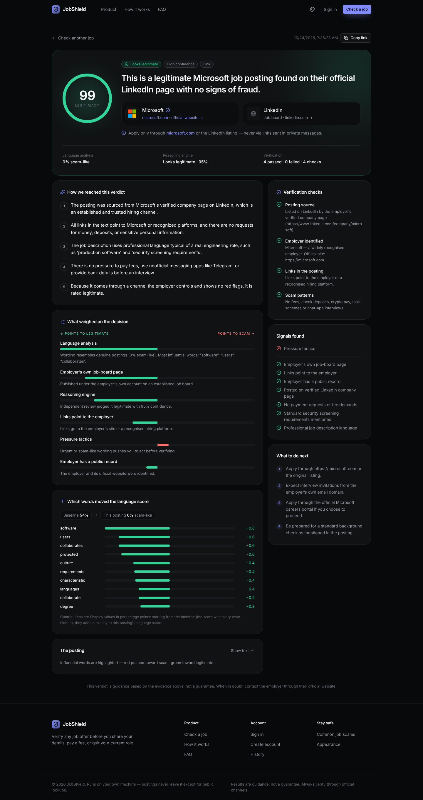

# JobShield

Check whether a job posting is real before you apply. Paste a link, message, screenshot or PDF:
JobShield traces where the posting came from, verifies who is really hiring, and explains its
verdict step by step.



## Quick start (Windows)

1. Download the repository (Code → Download ZIP) and unzip it.
2. Double-click **`start.bat`**. That's the only step.

On the first run it installs whatever the PC is missing — Python 3.12, Node.js, the Microsoft
Visual C++ runtime, Ollama and the local reasoning model (`qwen3.5:4b`, ~3 GB) — plus every
package, the headless browser and an embedded database, then opens **http://localhost:5001**.
No admin rights are needed; it uses `winget` and falls back to direct downloads. The first run
takes 10–30 minutes (mostly downloads); every later run starts in seconds.

Needs Windows 10/11, ~8 GB free disk and 8 GB RAM (16 GB recommended). macOS / Linux:
`./setup.sh` (needs Python 3.10–3.13 and Node.js 20+).

## How a verdict is made

| Signal | What it does |
|---|---|
| **Language analysis** | A fine-tuned DistilBERT + TF-IDF ensemble scores how much the wording resembles scams. SHAP values show which words moved the score. |
| **Scam-pattern rules** | Fees and deposits, fake-check / equipment scams, crypto pay, reshipping, task-and-commission schemes, ID harvesting, chat-app interviews. |
| **Source & employer verification** | Scrapes the link (LinkedIn guest pages, JSON-LD, trafilatura, headless browser fallback), identifies the employer and its official website (offline registry of 130+ employers → Wikidata → web search), and checks emails and links for free-mail recruiters, look-alike domains and newly registered domains. |
| **Reasoning engine** | A local open-source LLM served by [Ollama](https://ollama.com) reviews the posting together with all of the evidence above and explains its conclusion. |

A **fusion engine** (`ai_service/fusion/fuse.py`) weighs all four as an auditable evidence
ledger, with hard rules a careful person would apply: an employer-verified channel with no red
flags is rated ≥ 95 legitimate, and fee requests or brand impersonation are always scams. Each
stage degrades gracefully — without Ollama or internet access, the remaining signals still
produce a verdict and the report says what was unavailable.

Model metrics and data: [`docs/model_evaluation_report.md`](docs/model_evaluation_report.md).

## Architecture

```
frontend/   React + Vite + Tailwind + Motion — built and served by the backend
backend/    Node/Express — auth, history, rate limiting, persistence (MongoDB or embedded)
ai_service/ FastAPI — scraping, OCR, classifier (ONNX), verification, LLM reasoning, fusion, SHAP
launch.py   starts Ollama, the analysis service and the web app; `--dev` adds the Vite dev server
```

## Development

```bash
# analysis service
python -m venv ai_service/.venv && ai_service/.venv/bin/pip install -r ai_service/requirements.txt -r ai_service/requirements-dev.txt
PYTHONPATH=. ai_service/.venv/bin/python -m pytest -m "not slow"

# backend / frontend
cd backend && npm install && npm test
cd frontend && npm install && npm test && npm run build

python launch.py --dev
```

### Retraining the classifier

```bash
pip install -r ai_service/requirements-train.txt
python -m ai_service.dataset.build_training_corpus --raw-dir <folder with the downloaded datasets>
python -m ai_service.bert_model.train_model --fast        # ~30 min on a 4-core CPU
python -m ai_service.bert_model.train_model --epochs 2    # full run, better accuracy
```

Results are guidance, not a guarantee — always confirm a job through the employer's official
website.
